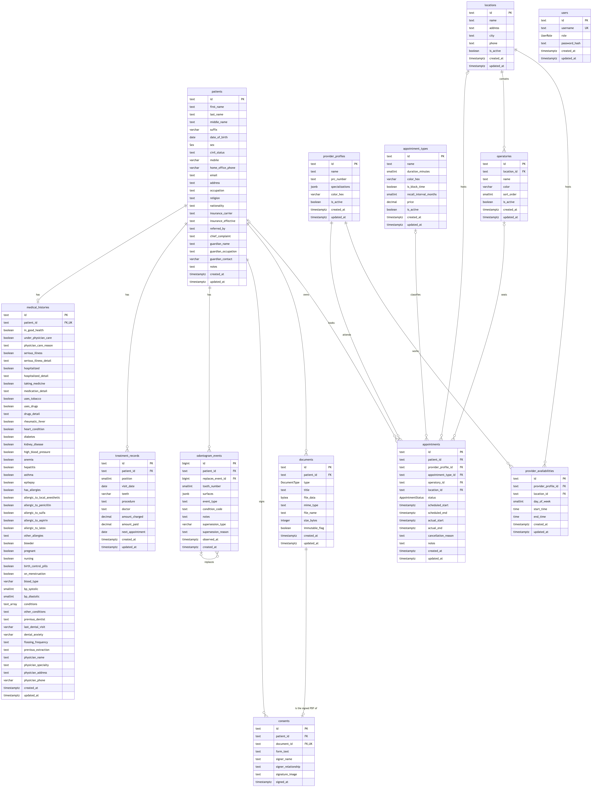

# DentaClub: Entity-Relationship Diagram

The full relational schema, with types, keys and constraints, is in [relational-schema.md](relational-schema.md).



**Reading the diagram:** `||` = exactly one, `o|` = zero or one, `o{` = zero or many. `PK` = primary key, `FK` = foreign key, `UK` = unique.

| Relationship | Cardinality |
|---|---|
| patient has medical history | 1 : 0..1 |
| patient has treatment records, chart events, documents, consents | 1 : 0..* |
| chart event replaces an earlier chart event (self-reference) | 0..1 : 0..* |
| document is the signed PDF of a consent | 1 : 0..1 |
| patient books appointments (none for block time) | 0..1 : 0..* |
| dentist attends appointments | 1 : 0..* |
| appointment type, chair or location of an appointment | 0..1 : 0..* |
| location contains chairs | 1 : 0..* |
| dentist works weekly availability windows at a location | 1 : 0..* each |
| users | stands alone (sign-in and roles: admin or staff) |

The diagram's source is [erd.mmd](erd.mmd). To regenerate the image after a schema change:

```bash
npx -y @mermaid-js/mermaid-cli -i docs/database/erd.mmd -o docs/database/erd.png -b white -w 2400 -s 2
```
